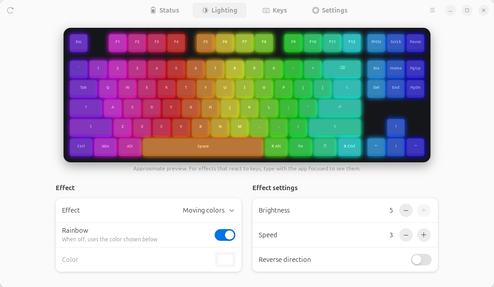
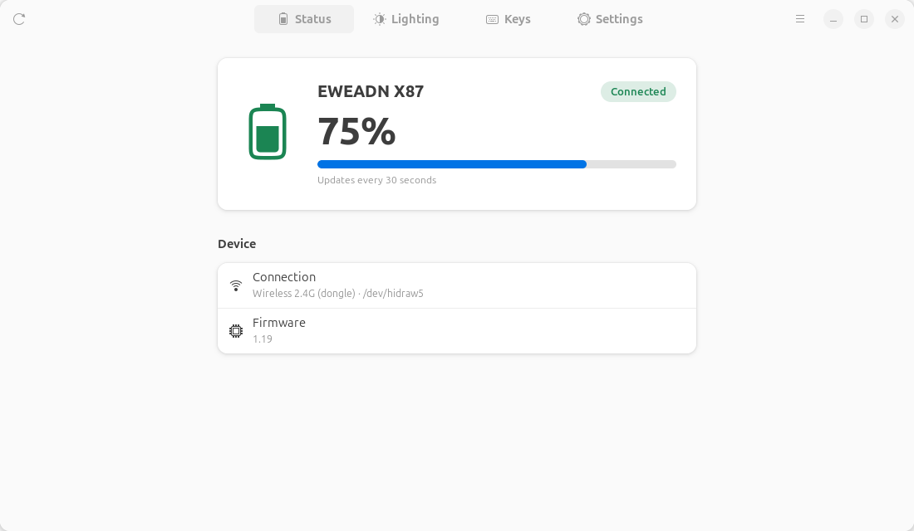
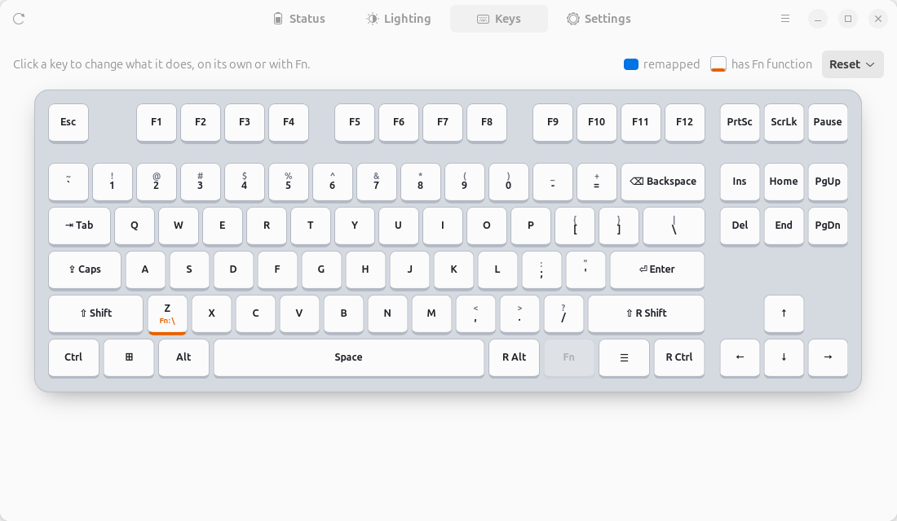
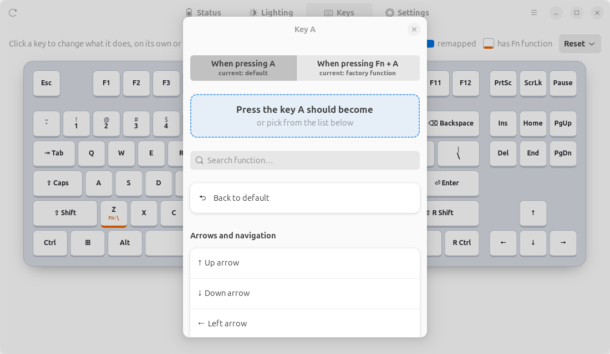

# EWEADN X87 for Linux

**English** · [Português](README.pt-BR.md)

An unofficial configurator for the **EWEADN X87** mechanical keyboard on Linux. The official
software only runs on Windows; this app talks to the keyboard directly over USB HID. It works
through the **2.4 GHz dongle** with no drivers and no extra services.

<picture><source media="(prefers-color-scheme: dark)" srcset="docs/screenshots/lighting-dark.png"></picture>

## Features

- **Battery and status**: battery level (refreshed every 30 s), firmware version and connection type.
- **RGB lighting**: 21 effects, rainbow/single color, brightness, speed and direction. An
  **animated keyboard preview** shows what each effect looks like; reactive effects respond to
  what you type.
- **Key remapping** on a true-to-scale TKL layout:
  - change what a key does on its own, **or only when Fn is held** (e.g. `Fn + A` → `↑`);
  - press the key you want to assign, or pick from a searchable list (keys, F13–F24, numpad,
    media keys, mouse buttons);
  - shows the character each key actually types on your **current system layout**
    (handy for ABNT2, ISO, etc. on an ANSI keyboard).
- **Sleep mode**: set the idle time or turn it off.
- **Light and dark themes**, **English and Portuguese** UI (automatic or chosen in the menu).
- **Command-line interface** for scripts.

Settings are written to the keyboard's own memory, so they keep working on any computer.

| Status | Keys | Remapping a key |
|---|---|---|
| <picture><source media="(prefers-color-scheme: dark)" srcset="docs/screenshots/status-dark.png"></picture> | <picture><source media="(prefers-color-scheme: dark)" srcset="docs/screenshots/keys-dark.png"></picture> | <picture><source media="(prefers-color-scheme: dark)" srcset="docs/screenshots/key-dialog-dark.png"></picture> |

## Supported hardware

| Device | USB ID | Status |
|---|---|---|
| EWEADN X87 via 2.4 GHz dongle | `0c45:fefe` | Tested (firmware 1.19) |
| EWEADN X87 via USB cable | `0c45:8006` | Should work, **untested** |

Other keyboards that use the same receiver (`0c45:fefe`, same OEM) may partially work, but the
key layout and effects are specific to the X87.

## Requirements

Linux with GTK 4 and libadwaita ≥ 1.5 (Ubuntu 24.04+, Fedora 40+, Debian 13+ or newer):

```bash
sudo apt install python3 python3-gi gir1.2-gtk-4.0 gir1.2-adw-1
```

## Installation

### Option 1: `.deb` package (Ubuntu / Debian)

Download `eweadn-x87_<version>_all.deb` from the [Releases](https://github.com/marcelowbr/eweadn-x87/releases) page, then:

```bash
sudo apt install ./eweadn-x87_*_all.deb
```

This adds **EWEADN X87** to the app menu, puts the `eweadn-x87` command on your PATH and installs
a udev rule so that any logged-in user can access the keyboard without `sudo`.

### Option 2: from source

```bash
git clone https://github.com/marcelowbr/eweadn-x87.git
cd eweadn-x87
scripts/install.sh      # installs for your user only, no sudo (--remover to uninstall)
```

Or run it without installing:

```bash
PYTHONPATH=src python3 -m eweadn_x87
```

It can also be installed with pip (GTK and PyGObject still come from the system packages):

```bash
pip install --user .
```

If the app says it has **no permission** to open `/dev/hidrawN`, install the udev rule once:

```bash
sudo install -m644 packaging/70-eweadn-x87.rules /etc/udev/rules.d/
sudo udevadm control --reload-rules && sudo udevadm trigger
```

### Building the packages

```bash
scripts/build.sh        # creates dist/eweadn-x87 (single-file executable) and dist/*.deb
```

`dist/eweadn-x87` is a Python zipapp: one file containing the whole app. It uses the system's
Python and GTK, which is why it is only ~25 KB.

## Command line

Running `eweadn-x87` without arguments opens the GUI. With arguments it works as a CLI:

```bash
eweadn-x87 info                                   # battery, firmware, sleep and lighting
eweadn-x87 effects                                # list lighting effects
eweadn-x87 led --mode 0x08 --brightness 3         # spectrum cycle, brightness 3/5
eweadn-x87 led --mode 0x01 --color ff0080         # static, custom color
eweadn-x87 sleep 0                                # disable sleep mode (or: sleep 10)
eweadn-x87 keys                                   # list remapped keys (normal and Fn layer)
eweadn-x87 reset-keys                             # reset all remaps
```

Portuguese command names also work (`efeitos`, `sono`, `teclas`, `resetar-teclas`).

## Known limitations

- **Remapped keys repeat in bursts when held.** The X87 firmware sends a quick press/release
  roughly every 130 ms while a remapped key (normal or Fn layer) is held, instead of holding it
  down. Unmapped keys behave normally. This is firmware behavior and it also happens with the
  official software. Tap remapped keys quickly; for arrows and navigation it acts like a
  normal key repeat.
- **Fn + F1…F12** have fixed factory functions and cannot be changed (same as the official app).
- **Custom RGB color:** the keyboard acknowledges the command, but on firmware 1.19 reading it
  back still returns the previous color. Effects, brightness, speed and rainbow mode are confirmed to work.
- **The lighting preview is an approximation**, built from each effect's name. The firmware does not
  describe its animations.
- Macros, the side light bar and firmware updates are **not supported**. This app never flashes firmware.

## Troubleshooting

**Keys type different characters than the keycaps.** The X87 has US ANSI keycaps. If your system
uses another layout (e.g. Brazilian ABNT2), switch to *English (US, intl., with dead keys)* to
match the keycaps; accents still work (`'` + `a` → `á`, AltGr + `,` → `ç`).

**`N: Download is performed unsandboxed as root…` when installing the .deb**
This is harmless: apt's sandbox user can't read your home folder. Copy the `.deb` to `/tmp` first
to avoid the message.

## How it works

The protocol was reverse-engineered from the official web configurator (for interoperability)
and verified against the hardware. It is documented in [docs/PROTOCOL.md](docs/PROTOCOL.md).

```
src/eweadn_x87/
├── __main__.py     entry point: GUI without arguments, CLI with arguments
├── protocol.py     HID protocol and device access
├── cli.py          command-line interface
├── gui.py          GTK 4 / libadwaita interface
├── preview.py      animated lighting preview
└── i18n.py         English/Portuguese strings
scripts/            build.sh (executable + .deb), install.sh (per-user install)
packaging/          desktop entry, icon and udev rule
docs/               protocol documentation and screenshots
```

## Disclaimer

This project is not affiliated with, endorsed by or supported by EWEADN. "EWEADN" and "X87" are
trademarks of their respective owners. The app only uses the same configuration commands as the
official software, but writing settings to a device is always at your own risk.

## License

[MIT](LICENSE)
