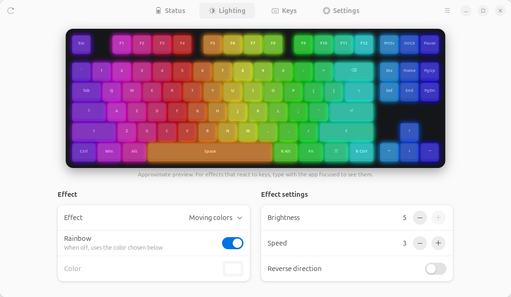
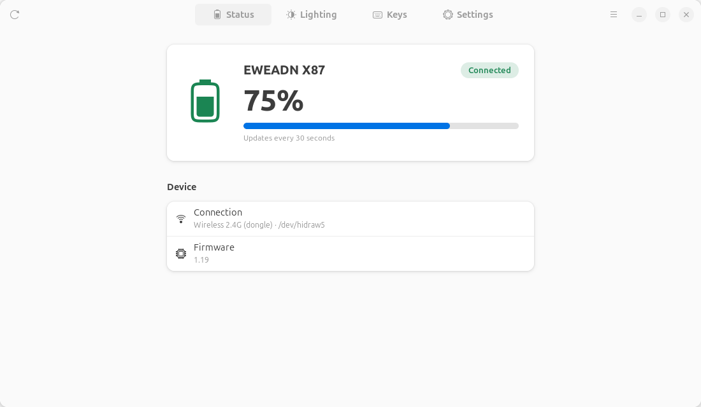
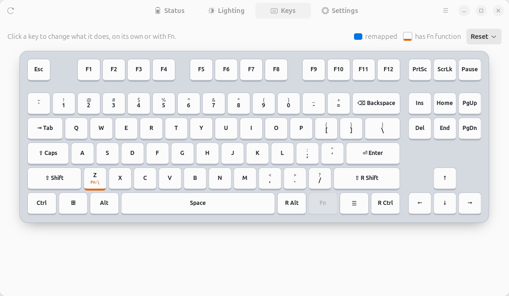
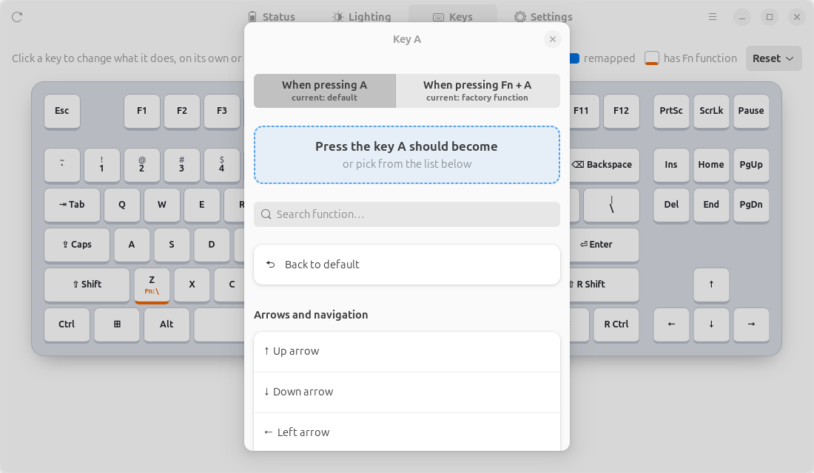

# EWEADN X87 para Linux

[English](README.md) · **Português**

Configurador não oficial do teclado mecânico **EWEADN X87** para Linux. O software oficial só
roda no Windows; este app conversa direto com o teclado via USB HID. Ele funciona pelo
**dongle 2.4 GHz**, sem drivers e sem serviços extras.

<picture><source media="(prefers-color-scheme: dark)" srcset="docs/screenshots/lighting-dark.png"></picture>

## Funções

- **Bateria e status**: nível da bateria (atualizado a cada 30 s), versão do firmware e tipo de conexão.
- **Iluminação RGB**: 21 efeitos, arco-íris ou cor única, brilho, velocidade e direção. Uma
  **pré-visualização animada do teclado** mostra como cada efeito fica; os efeitos reativos
  respondem ao que você digita.
- **Remapeamento de teclas** num desenho TKL em escala real:
  - mude o que uma tecla faz sozinha **ou só quando Fn está pressionado** (ex.: `Fn + A` → `↑`);
  - aperte a tecla que você quer atribuir, ou escolha numa lista com busca (teclas, F13–F24,
    teclado numérico, mídia, botões de mouse);
  - mostra o caractere que cada tecla realmente digita no **layout atual do sistema**
    (útil para ABNT2, ISO etc. num teclado ANSI).
- **Modo de sono**: define o tempo de inatividade ou desliga.
- **Temas claro e escuro**, interface em **português e inglês** (automático ou escolhido no menu).
- **Linha de comando** para scripts.

As configurações são gravadas na memória do próprio teclado, então funcionam em qualquer computador.

| Status | Teclas | Remapeando uma tecla |
|---|---|---|
| <picture><source media="(prefers-color-scheme: dark)" srcset="docs/screenshots/status-dark.png"></picture> | <picture><source media="(prefers-color-scheme: dark)" srcset="docs/screenshots/keys-dark.png"></picture> | <picture><source media="(prefers-color-scheme: dark)" srcset="docs/screenshots/key-dialog-dark.png"></picture> |

## Hardware suportado

| Aparelho | ID USB | Situação |
|---|---|---|
| EWEADN X87 pelo dongle 2.4 GHz | `0c45:fefe` | Testado (firmware 1.19) |
| EWEADN X87 pelo cabo USB | `0c45:8006` | Deve funcionar, **não testado** |

Outros teclados que usam o mesmo receptor (`0c45:fefe`, mesmo fabricante OEM) podem funcionar em
parte, mas o layout de teclas e os efeitos são específicos do X87.

## Requisitos

Linux com GTK 4 e libadwaita ≥ 1.5 (Ubuntu 24.04+, Fedora 40+, Debian 13+ ou mais novos):

```bash
sudo apt install python3 python3-gi gir1.2-gtk-4.0 gir1.2-adw-1
```

## Instalação

### Opção 1: pacote `.deb` (Ubuntu / Debian)

Baixe `eweadn-x87_<versão>_all.deb` na página de [Releases](https://github.com/marcelowbr/eweadn-x87/releases) e rode:

```bash
sudo apt install ./eweadn-x87_*_all.deb
```

Isso coloca o **EWEADN X87** no menu de aplicativos, deixa o comando `eweadn-x87` disponível no
terminal e instala uma regra udev para qualquer usuário logado acessar o teclado sem `sudo`.

### Opção 2: pelo código-fonte

```bash
git clone https://github.com/marcelowbr/eweadn-x87.git
cd eweadn-x87
scripts/install.sh      # instala só para o seu usuário, sem sudo (--remover desinstala)
```

Ou rode sem instalar:

```bash
PYTHONPATH=src python3 -m eweadn_x87
```

Também dá para instalar com pip (o GTK e o PyGObject continuam vindo dos pacotes do sistema):

```bash
pip install --user .
```

Se o app disser que está **sem permissão** para abrir `/dev/hidrawN`, instale a regra udev uma vez:

```bash
sudo install -m644 packaging/70-eweadn-x87.rules /etc/udev/rules.d/
sudo udevadm control --reload-rules && sudo udevadm trigger
```

### Gerando os pacotes

```bash
scripts/build.sh        # cria dist/eweadn-x87 (executável único) e dist/*.deb
```

O `dist/eweadn-x87` é um zipapp do Python: um único arquivo com o app inteiro. Ele usa o Python
e o GTK do sistema, por isso tem só ~25 KB.

## Linha de comando

Sem argumentos, `eweadn-x87` abre a interface. Com argumentos, funciona como linha de comando:

```bash
eweadn-x87 info                                   # bateria, firmware, sono e iluminação
eweadn-x87 efeitos                                # lista os efeitos de luz
eweadn-x87 led --modo 0x08 --brilho 3             # ciclo espectral, brilho 3/5
eweadn-x87 led --modo 0x01 --cor ff0080           # estático, cor personalizada
eweadn-x87 sono 0                                 # desliga o modo de sono (ou: sono 10)
eweadn-x87 teclas                                 # lista teclas remapeadas (normal e camada Fn)
eweadn-x87 resetar-teclas                         # desfaz todos os remapeamentos
```

Os nomes em inglês também funcionam (`effects`, `sleep`, `keys`, `reset-keys`, `--mode`, `--color`…).

## Limitações conhecidas

- **Teclas remapeadas repetem em rajada quando seguradas.** Enquanto você segura uma tecla
  remapeada (camada normal ou Fn), o firmware do X87 manda um "aperta/solta" a cada ~130 ms, em
  vez de mantê-la pressionada. Teclas sem remapeamento funcionam normalmente. É comportamento do
  firmware e acontece também no software oficial. Dê toques rápidos nas teclas remapeadas; para
  setas e navegação, funciona como a repetição normal.
- **Fn + F1…F12** são funções fixas de fábrica e não podem ser trocadas (igual ao app oficial).
- **Cor RGB personalizada:** o teclado confirma o comando, mas no firmware 1.19 a leitura continua
  mostrando a cor anterior. Efeitos, brilho, velocidade e modo arco-íris funcionam comprovadamente.
- **A pré-visualização da iluminação é uma aproximação**, montada a partir do nome de cada efeito.
  O firmware não informa como desenha as animações.
- Macros, barra de luz lateral e atualização de firmware **não são suportados**. O app nunca grava firmware.

## Solução de problemas

**As teclas digitam caracteres diferentes dos impressos.** O X87 tem keycaps no padrão americano
(ANSI). Se o sistema usa outro layout (ex.: ABNT2), troque para *Inglês (EUA, internacional, com
teclas mortas)*; os acentos continuam funcionando (`'` + `a` → `á`, AltGr + `,` → `ç`).

**`N: Download is performed unsandboxed as root…` ao instalar o .deb**
É só um aviso: o usuário restrito do apt não consegue ler a sua pasta pessoal. Copie o `.deb`
para `/tmp` antes de instalar para não ver a mensagem.

## Como funciona

O protocolo foi descoberto por engenharia reversa do configurador web oficial (para
interoperabilidade) e conferido no hardware. A documentação está em
[docs/PROTOCOL.md](docs/PROTOCOL.md) (em inglês).

```
src/eweadn_x87/
├── __main__.py     ponto de entrada: interface sem argumentos, linha de comando com argumentos
├── protocol.py     protocolo HID e acesso ao aparelho
├── cli.py          linha de comando
├── gui.py          interface GTK 4 / libadwaita
├── preview.py      pré-visualização animada da iluminação
└── i18n.py         textos em português e inglês
scripts/            build.sh (executável + .deb), install.sh (instalação por usuário)
packaging/          atalho do menu, ícone e regra udev
docs/               documentação do protocolo e capturas de tela
```

## Aviso

Este projeto não é afiliado, endossado nem suportado pela EWEADN. "EWEADN" e "X87" são marcas de
seus respectivos donos. O app usa apenas os mesmos comandos de configuração do software oficial,
mas gravar configurações num aparelho é sempre por sua conta e risco.

## Licença

[MIT](LICENSE)
